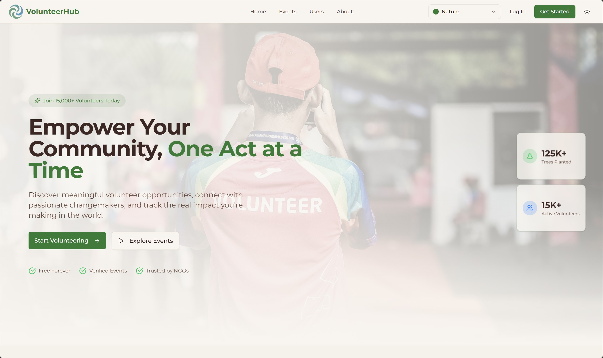
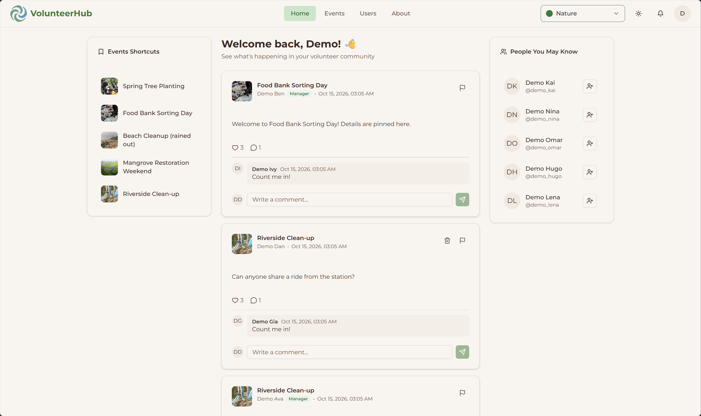
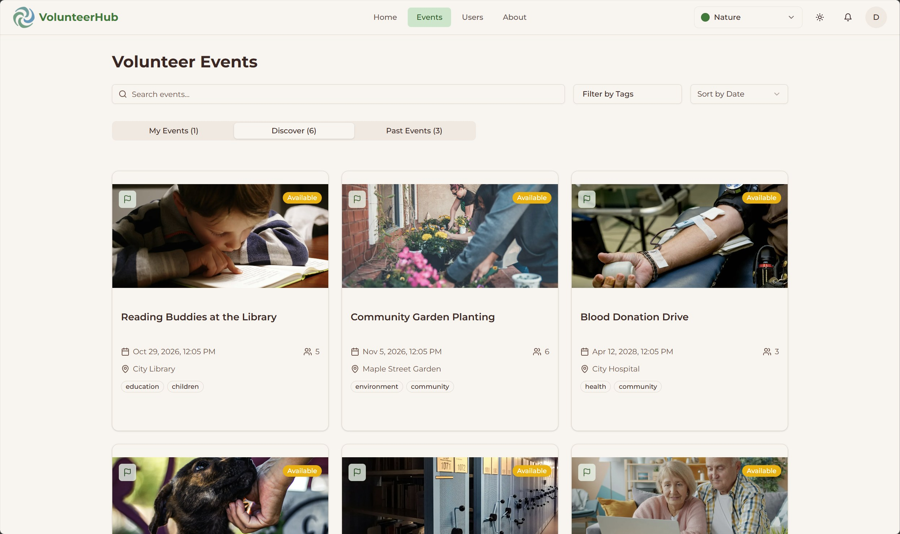
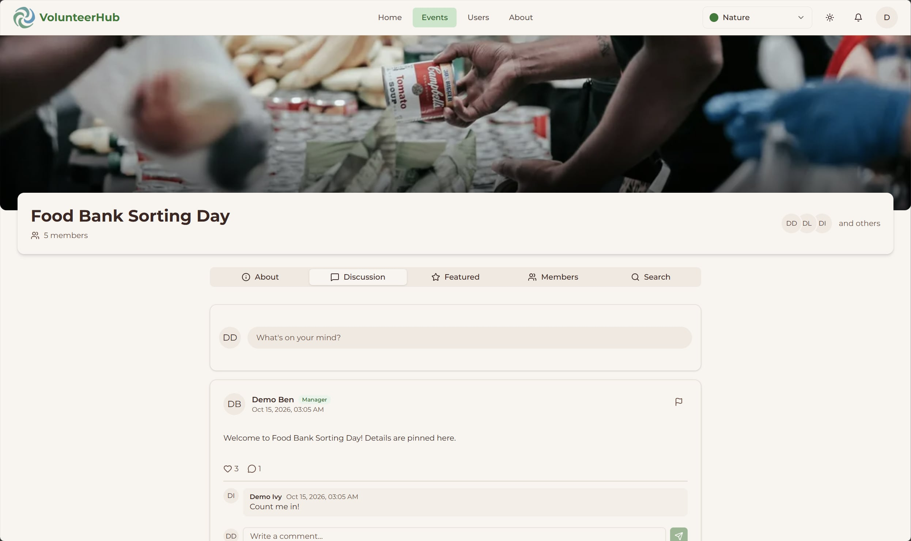
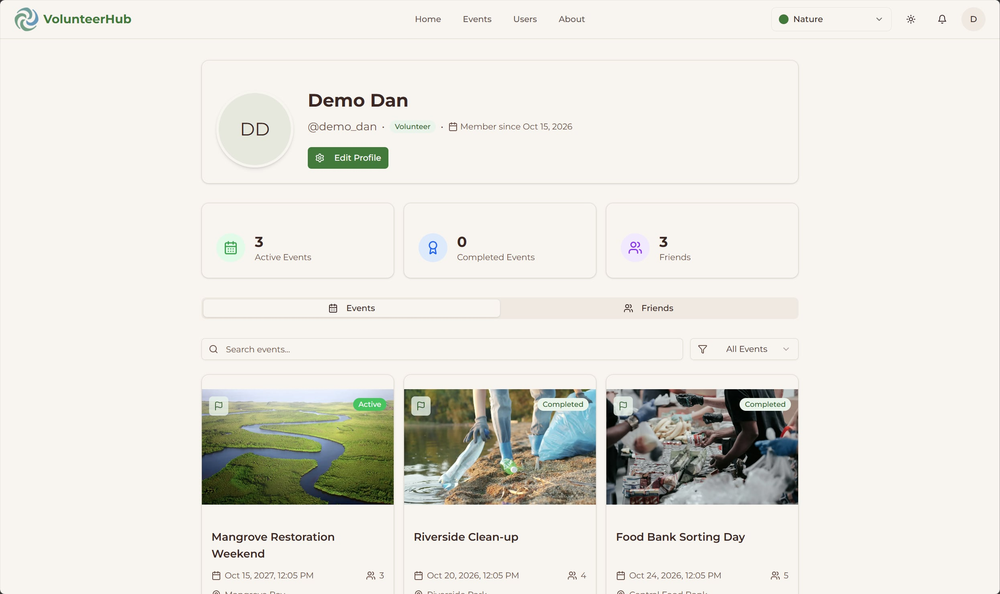
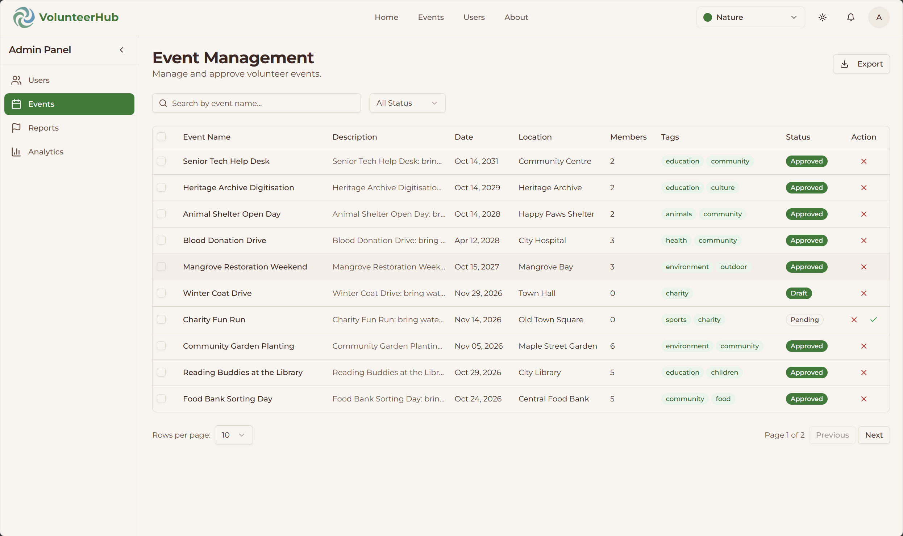
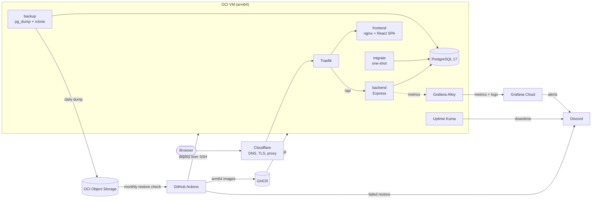

<div align="center">

# VolunteerHub

[](https://github.com/14m6d4/VolunteerHub/actions/workflows/ci.yml)
[](https://github.com/14m6d4/VolunteerHub/actions/workflows/restore-check.yml)
[](https://volunteerhub.l4mbd4.me)
[](https://github.com/14m6d4/VolunteerHub/commits/main)
[](LICENSE)

[](https://orm.drizzle.team)
[](https://zod.dev)
[](https://ui.shadcn.com)
[](https://traefik.io)

[](#tech-stack)

A volunteer event platform. Volunteers find events, sign up and talk about them, managers publish and run events, and admins moderate the site.

Live at <https://volunteerhub.l4mbd4.me>.

</div>

## Features

### Volunteers

- Browse events with search, tag filters and sorting, split into your events, new ones and past ones
- Sign up for an event or cancel; the event's manager approves each registration
- Talk in each event's discussion: posts with images, likes, comments and a members list
- Follow a personal feed of posts from your events, mixed with trending events
- Send and answer friend requests, and get friend suggestions based on mutual friends
- Get notifications about registrations, event changes, friend requests, likes, comments and reports
- Report a user, an event or a post
- Keep a public profile with stats, events and friends; change your name, username, profile picture and password

### Managers

- Create, edit and delete events with a cover image, date and time
- Approve, reject or remove registrations, one at a time or all at once
- Mark an event finished, which completes its registrations
- Resolve or reject reports about their own events

### Admins

- Approve new events before they go public
- Manage users: search, filter by role and status, create, edit, ban with a reason, unban, delete, act in bulk
- Manage every event and report; resolving a report removes the post or bans the user
- Export users and events as CSV or JSON
- Read the analytics dashboard: user growth, events per month and by status, volunteer participation, top tags and reports by reason

### Accounts and appearance

- Sign up with an email verification code and reset a forgotten password by email
- Banned users see the reason and the end date of their ban
- Light, dark or system mode, plus 9 color themes (Default, Vintage Paper, Neo Brutalism, Doom 64, Nature, Everforest, Bubblegum, Perpetuity, Notebook), each with its own fonts

## Screenshots

<table>
  <tr>
    <td><br><sub>Landing page</sub></td>
    <td><br><sub>Feed</sub></td>
  </tr>
  <tr>
    <td><br><sub>Events</sub></td>
    <td><br><sub>Event discussion</sub></td>
  </tr>
  <tr>
    <td><br><sub>Profile</sub></td>
    <td><br><sub>Admin: event management</sub></td>
  </tr>
</table>

## Tech stack

| Layer | Tools |
| --- | --- |
| Frontend | React 19, Vite, TypeScript, Tailwind CSS v4, shadcn/ui (Radix), TanStack Query, React Router 7, React Hook Form, Recharts |
| Backend | Node.js, Express 5, TypeScript, Drizzle ORM, Zod, JWT, Multer and sharp, Nodemailer, pino, prom-client |
| Database | PostgreSQL 17 |
| Infrastructure | Docker Compose on an OCI arm64 VM, Traefik, nginx, Cloudflare, GitHub Actions, GHCR |
| Operations | Grafana Cloud with Grafana Alloy, Uptime Kuma, Discord alerts, daily dumps to OCI Object Storage |

## Architecture



The backend is a layered REST API: routes wire the middleware (JWT auth, role checks, Zod validation, uploads), thin controllers parse the request, and services hold the business logic and the Drizzle queries. The frontend is a single-page app whose pages call the API through one fetch wrapper, with TanStack Query caching the results. Each push to `main` is checked, built into arm64 images and deployed to the VM, and a failed deploy rolls back by itself.

More detail: [architecture](docs/architecture.md), [deployment](docs/deployment.md), [operations](docs/operations.md).

## Repository layout

```
backend/    Express API: routes, controllers, services, Drizzle schema and migrations
frontend/   React SPA: pages, feature components, API services and hooks
backup/     image for the daily database backup job
docs/       project docs and architecture decision records
.github/    CI/CD and the monthly restore check
```

## Quick start

You need Node.js and Docker. Start a database and the API:

```
docker compose up -d postgres
cp backend/.env.example backend/.env    # then set DATABASE_URL's host to localhost and fill in the secrets
cd backend
npm i
npm run db:migrate
npm run db:seed    # optional demo data; prints the demo accounts' password
npm run dev
```

Then, in another terminal, the web app:

```
cd frontend
npm i
echo "VITE_API_URL=http://localhost:5000/api" > .env
npm run dev
```

The app runs at <http://localhost:5173>. To run everything in Docker with hot reload instead, and for the behaviour checks, see [development](docs/development.md).

## Documentation

- [Architecture](docs/architecture.md): how the backend and frontend are put together, and the API's domains
- [Development](docs/development.md): local setup, the Docker dev stack, database tasks and checks
- [Deployment](docs/deployment.md): the path from a commit to production, rollbacks and migration rules
- [Operations](docs/operations.md): monitoring, alerts, backups and restore drills
- [Glossary](GLOSSARY.md): the domain terms the code and docs use
- [Architecture decision records](docs/adr/)
- [Coding standards](CODING_STANDARDS.md)

## License

[MIT](LICENSE)
